<!--
  GitHub profile README for mhanikbd (Mehedi Hasan Anik).
  Every graphic in assets/ is generated from profile.psd1. See docs/MAINTAINING.md.
-->

  <picture>
    <source media="(prefers-color-scheme: dark)" srcset="https://raw.githubusercontent.com/mhanikbd/mhanikbd/main/assets/hero/hero-banner-dark.svg">
    <source media="(prefers-color-scheme: light)" srcset="https://raw.githubusercontent.com/mhanikbd/mhanikbd/main/assets/hero/hero-banner-light.svg">
    
  </picture>

  <a href="https://github.com/mhanikbd?tab=repositories"><picture><source media="(prefers-color-scheme: dark)" srcset="https://raw.githubusercontent.com/mhanikbd/mhanikbd/main/assets/icons/button-github-dark.svg"><source media="(prefers-color-scheme: light)" srcset="https://raw.githubusercontent.com/mhanikbd/mhanikbd/main/assets/icons/button-github-light.svg"></picture></a>
  <!-- LINKEDIN: replace YOUR-LINKEDIN-URL, then remove the comment markers on this line.
  <a href="YOUR-LINKEDIN-URL"><picture><source media="(prefers-color-scheme: dark)" srcset="https://raw.githubusercontent.com/mhanikbd/mhanikbd/main/assets/icons/button-linkedin-dark.svg"><source media="(prefers-color-scheme: light)" srcset="https://raw.githubusercontent.com/mhanikbd/mhanikbd/main/assets/icons/button-linkedin-light.svg"></picture></a>
  -->
  <!-- WEBSITE: replace YOUR-WEBSITE-URL, then remove the comment markers on this line.
  <a href="YOUR-WEBSITE-URL"><picture><source media="(prefers-color-scheme: dark)" srcset="https://raw.githubusercontent.com/mhanikbd/mhanikbd/main/assets/icons/button-website-dark.svg"><source media="(prefers-color-scheme: light)" srcset="https://raw.githubusercontent.com/mhanikbd/mhanikbd/main/assets/icons/button-website-light.svg"></picture></a>
  -->

  <b>Turning ideas into technology. Transforming technology into impact.</b>

  <a href="#about">About</a>&nbsp;&nbsp;&middot;&nbsp;&nbsp;<a href="#journey">Journey</a>&nbsp;&nbsp;&middot;&nbsp;&nbsp;<a href="#work">Work</a>&nbsp;&nbsp;&middot;&nbsp;&nbsp;<a href="#capabilities">Capabilities</a>&nbsp;&nbsp;&middot;&nbsp;&nbsp;<a href="#activity">Activity</a>&nbsp;&nbsp;&middot;&nbsp;&nbsp;<a href="#connect">Connect</a>

 

  
  <picture>
    <source media="(prefers-color-scheme: dark)" srcset="https://raw.githubusercontent.com/mhanikbd/mhanikbd/main/assets/section-graphics/header-about-dark.svg">
    <source media="(prefers-color-scheme: light)" srcset="https://raw.githubusercontent.com/mhanikbd/mhanikbd/main/assets/section-graphics/header-about-light.svg">
    
  </picture>

<picture>
  <source media="(prefers-color-scheme: dark)" srcset="https://raw.githubusercontent.com/mhanikbd/mhanikbd/main/assets/section-graphics/about-code-dark.svg">
  <source media="(prefers-color-scheme: light)" srcset="https://raw.githubusercontent.com/mhanikbd/mhanikbd/main/assets/section-graphics/about-code-light.svg">
  
</picture>

I'm **Mehedi Hasan Anik**, an enterprise product and project leader based in Dhaka, Bangladesh, currently at **naztech Inc**. I work where business, people and technology meet, turning ideas and complex requirements into products that teams can deliver and people can use.

My path runs from code to strategy. I started in 2018 as a freelance developer, moved into professional web development, and then into business analysis, solution design and product roadmap ownership. Today I lead enterprise product delivery, with AI built into how the work gets done.

Having been the developer, the analyst and the delivery lead, I can translate between stakeholders, users and engineers, and keep all three moving toward the same outcome.

**How I create value**

- Turning unclear business needs into clear requirements and solution designs
- Planning and delivering enterprise and banking products, from roadmap to release
- Using AI to prototype, build and automate faster

 

  <picture>
    <source media="(prefers-color-scheme: dark)" srcset="https://raw.githubusercontent.com/mhanikbd/mhanikbd/main/assets/section-graphics/clients-dark.svg">
    <source media="(prefers-color-scheme: light)" srcset="https://raw.githubusercontent.com/mhanikbd/mhanikbd/main/assets/section-graphics/clients-light.svg">
    
  </picture>

 

  
  <picture>
    <source media="(prefers-color-scheme: dark)" srcset="https://raw.githubusercontent.com/mhanikbd/mhanikbd/main/assets/section-graphics/header-journey-dark.svg">
    <source media="(prefers-color-scheme: light)" srcset="https://raw.githubusercontent.com/mhanikbd/mhanikbd/main/assets/section-graphics/header-journey-light.svg">
    
  </picture>

  <picture>
    <source media="(prefers-color-scheme: dark)" srcset="https://raw.githubusercontent.com/mhanikbd/mhanikbd/main/assets/career/career-timeline-dark.svg">
    <source media="(prefers-color-scheme: light)" srcset="https://raw.githubusercontent.com/mhanikbd/mhanikbd/main/assets/career/career-timeline-light.svg">
    
  </picture>

 

  
  <picture>
    <source media="(prefers-color-scheme: dark)" srcset="https://raw.githubusercontent.com/mhanikbd/mhanikbd/main/assets/section-graphics/header-work-dark.svg">
    <source media="(prefers-color-scheme: light)" srcset="https://raw.githubusercontent.com/mhanikbd/mhanikbd/main/assets/section-graphics/header-work-light.svg">
    
  </picture>

  <picture>
    <source media="(prefers-color-scheme: dark)" srcset="https://raw.githubusercontent.com/mhanikbd/mhanikbd/main/assets/project-banners/practice-areas-dark.svg">
    <source media="(prefers-color-scheme: light)" srcset="https://raw.githubusercontent.com/mhanikbd/mhanikbd/main/assets/project-banners/practice-areas-light.svg">
    
  </picture>

  <a href="https://github.com/mhanikbd/Digital_Lending_Platform"><picture>
    <source media="(prefers-color-scheme: dark)" srcset="https://raw.githubusercontent.com/mhanikbd/mhanikbd/main/assets/project-banners/digital-lending-platform-dark.svg">
    <source media="(prefers-color-scheme: light)" srcset="https://raw.githubusercontent.com/mhanikbd/mhanikbd/main/assets/project-banners/digital-lending-platform-light.svg">
    
  </picture></a>

<b>Case notes: Digital Lending Platform</b>

 

| | |
| --- | --- |
| **Industry** | Banking and financial services |
| **Challenge** | Banks need to launch new loan products without building a new system each time, while keeping approvals, credit policy and regulatory classification under control. |
| **Solution** | A configuration-driven platform where products, eligibility rules, approval tiers, repayment waterfalls and arrears classification are stored as data, not code. It covers customer onboarding and e-KYC, credit scoring and screening, approval, disbursement through the core banking system, repayments and collections. |
| **Delivery** | Team project at naztech |
| **Stack** | Java 21, Spring Boot, Next.js, TypeScript, PostgreSQL, Redis, MinIO, Docker |
| **Status** | In active development |

  <a href="https://github.com/mhanikbd/Transcribe-Studio---Extract-Audio-To-Text-in-Word-Excel-txt-PDF"><picture>
    <source media="(prefers-color-scheme: dark)" srcset="https://raw.githubusercontent.com/mhanikbd/mhanikbd/main/assets/project-banners/transcribe-studio-dark.svg">
    <source media="(prefers-color-scheme: light)" srcset="https://raw.githubusercontent.com/mhanikbd/mhanikbd/main/assets/project-banners/transcribe-studio-light.svg">
    
  </picture></a>
  <a href="https://github.com/mhanikbd/ReelsMaker"><picture>
    <source media="(prefers-color-scheme: dark)" srcset="https://raw.githubusercontent.com/mhanikbd/mhanikbd/main/assets/project-banners/reelsmaker-dark.svg">
    <source media="(prefers-color-scheme: light)" srcset="https://raw.githubusercontent.com/mhanikbd/mhanikbd/main/assets/project-banners/reelsmaker-light.svg">
    
  </picture></a>

<b>Case notes: Transcribe Studio</b>

 

| | |
| --- | --- |
| **Industry** | Productivity and meeting operations |
| **Challenge** | Long meetings recorded in a mix of Bangla and English are slow to write up, and sending sensitive recordings to cloud services is often not an option. |
| **Solution** | A local web app that runs OpenAI's Whisper large-v3 model through faster-whisper on the GPU. It adds a transcript editor, search, click-to-play timestamps, and exports to Word, PDF, TXT and SRT. An optional public mode adds per-visitor privacy, a fair queue, upload limits and a Cloudflare Turnstile bot check. |
| **Role** | Personal project |
| **Stack** | Python, FastAPI, faster-whisper, FFmpeg, Cloudflare Tunnel |

<b>Case notes: ReelsMaker</b>

 

| | |
| --- | --- |
| **Industry** | Marketing and content creation |
| **Challenge** | Short-form video ads usually need editing software or a video team. |
| **Solution** | A single HTML file where a business enters its name, logo, slides and style. The app previews the reel at 30 fps and encodes a 1080×1920 MP4 in the browser with WebCodecs, falling back to WebM where H.264 encoding is not available. |
| **Role** | Personal project |
| **Stack** | React 18, Tailwind CSS, WebCodecs, mp4-muxer |

  <a href="https://github.com/mhanikbd/ComingSoon_BGOFashion"><picture>
    <source media="(prefers-color-scheme: dark)" srcset="https://raw.githubusercontent.com/mhanikbd/mhanikbd/main/assets/project-banners/bgo-fashion-dark.svg">
    <source media="(prefers-color-scheme: light)" srcset="https://raw.githubusercontent.com/mhanikbd/mhanikbd/main/assets/project-banners/bgo-fashion-light.svg">
    
  </picture></a>
  <a href="https://github.com/mhanikbd?tab=repositories"><picture>
    <source media="(prefers-color-scheme: dark)" srcset="https://raw.githubusercontent.com/mhanikbd/mhanikbd/main/assets/project-banners/more-repos-dark.svg">
    <source media="(prefers-color-scheme: light)" srcset="https://raw.githubusercontent.com/mhanikbd/mhanikbd/main/assets/project-banners/more-repos-light.svg">
    
  </picture></a>

<b>Case notes: BGO Fashion</b>

 

| | |
| --- | --- |
| **Industry** | Fashion retail |
| **Challenge** | A new fashion brand needed to build interest and take orders before its full launch. |
| **Solution** | A pre-launch website with limited-time launch offers, a product showcase, and a cash-on-delivery pre-order form that leads to an order confirmation page. |
| **Role** | Website build |
| **Stack** | HTML, CSS, JavaScript, Bootstrap 5 |

 

  
  <picture>
    <source media="(prefers-color-scheme: dark)" srcset="https://raw.githubusercontent.com/mhanikbd/mhanikbd/main/assets/section-graphics/header-capabilities-dark.svg">
    <source media="(prefers-color-scheme: light)" srcset="https://raw.githubusercontent.com/mhanikbd/mhanikbd/main/assets/section-graphics/header-capabilities-light.svg">
    
  </picture>

  <picture>
    <source media="(prefers-color-scheme: dark)" srcset="https://raw.githubusercontent.com/mhanikbd/mhanikbd/main/assets/section-graphics/capabilities-dark.svg">
    <source media="(prefers-color-scheme: light)" srcset="https://raw.githubusercontent.com/mhanikbd/mhanikbd/main/assets/section-graphics/capabilities-light.svg">
    
  </picture>

 

  
  <picture>
    <source media="(prefers-color-scheme: dark)" srcset="https://raw.githubusercontent.com/mhanikbd/mhanikbd/main/assets/section-graphics/header-activity-dark.svg">
    <source media="(prefers-color-scheme: light)" srcset="https://raw.githubusercontent.com/mhanikbd/mhanikbd/main/assets/section-graphics/header-activity-light.svg">
    
  </picture>

  <picture>
    <source media="(prefers-color-scheme: dark)" srcset="https://raw.githubusercontent.com/mhanikbd/mhanikbd/main/assets/activity/stats-dark.svg">
    <source media="(prefers-color-scheme: light)" srcset="https://raw.githubusercontent.com/mhanikbd/mhanikbd/main/assets/activity/stats-light.svg">
    
  </picture>

  <picture>
    <source media="(prefers-color-scheme: dark)" srcset="https://raw.githubusercontent.com/mhanikbd/mhanikbd/main/assets/activity/snake-dark.svg">
    <source media="(prefers-color-scheme: light)" srcset="https://raw.githubusercontent.com/mhanikbd/mhanikbd/main/assets/activity/snake-light.svg">
    
  </picture>

Generated daily from public GitHub data. Client and enterprise work is not shown here.

 

  
  <picture>
    <source media="(prefers-color-scheme: dark)" srcset="https://raw.githubusercontent.com/mhanikbd/mhanikbd/main/assets/section-graphics/header-vision-dark.svg">
    <source media="(prefers-color-scheme: light)" srcset="https://raw.githubusercontent.com/mhanikbd/mhanikbd/main/assets/section-graphics/header-vision-light.svg">
    
  </picture>

  <picture>
    <source media="(prefers-color-scheme: dark)" srcset="https://raw.githubusercontent.com/mhanikbd/mhanikbd/main/assets/section-graphics/philosophy-dark.svg">
    <source media="(prefers-color-scheme: light)" srcset="https://raw.githubusercontent.com/mhanikbd/mhanikbd/main/assets/section-graphics/philosophy-light.svg">
    
  </picture>

 

  
  <picture>
    <source media="(prefers-color-scheme: dark)" srcset="https://raw.githubusercontent.com/mhanikbd/mhanikbd/main/assets/section-graphics/header-connect-dark.svg">
    <source media="(prefers-color-scheme: light)" srcset="https://raw.githubusercontent.com/mhanikbd/mhanikbd/main/assets/section-graphics/header-connect-light.svg">
    
  </picture>

  <picture>
    <source media="(prefers-color-scheme: dark)" srcset="https://raw.githubusercontent.com/mhanikbd/mhanikbd/main/assets/section-graphics/connect-dark.svg">
    <source media="(prefers-color-scheme: light)" srcset="https://raw.githubusercontent.com/mhanikbd/mhanikbd/main/assets/section-graphics/connect-light.svg">
    
  </picture>

  <a href="https://github.com/mhanikbd?tab=repositories"><picture><source media="(prefers-color-scheme: dark)" srcset="https://raw.githubusercontent.com/mhanikbd/mhanikbd/main/assets/icons/button-github-dark.svg"><source media="(prefers-color-scheme: light)" srcset="https://raw.githubusercontent.com/mhanikbd/mhanikbd/main/assets/icons/button-github-light.svg"></picture></a>
  <!-- EMAIL: replace YOUR-EMAIL, then remove the comment markers on this line.
  <a href="mailto:YOUR-EMAIL"><picture><source media="(prefers-color-scheme: dark)" srcset="https://raw.githubusercontent.com/mhanikbd/mhanikbd/main/assets/icons/button-email-dark.svg"><source media="(prefers-color-scheme: light)" srcset="https://raw.githubusercontent.com/mhanikbd/mhanikbd/main/assets/icons/button-email-light.svg"></picture></a>
  -->
  <!-- LINKEDIN: replace YOUR-LINKEDIN-URL, then remove the comment markers on this line.
  <a href="YOUR-LINKEDIN-URL"><picture><source media="(prefers-color-scheme: dark)" srcset="https://raw.githubusercontent.com/mhanikbd/mhanikbd/main/assets/icons/button-linkedin-dark.svg"><source media="(prefers-color-scheme: light)" srcset="https://raw.githubusercontent.com/mhanikbd/mhanikbd/main/assets/icons/button-linkedin-light.svg"></picture></a>
  -->

  <picture>
    <source media="(prefers-color-scheme: dark)" srcset="https://raw.githubusercontent.com/mhanikbd/mhanikbd/main/assets/section-graphics/footer-dark.svg">
    <source media="(prefers-color-scheme: light)" srcset="https://raw.githubusercontent.com/mhanikbd/mhanikbd/main/assets/section-graphics/footer-light.svg">
    
  </picture>

<a href="#top">Back to top</a>

